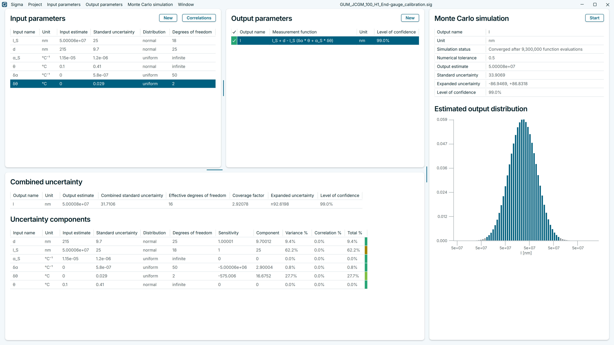

# Sigma - Measurement Uncertainty Toolkit 
*Sigma – Measurement Uncertainty Toolkit* is a desktop and command-line application for interactive and automated measurement uncertainty analysis. It implements the classical GUM (Guide to the expression of Uncertainty in Measurement) method ([JCGM 100:2008](https://doi.org/10.59161/JCGM100-2008E)) for combined uncertainty and uncertainty budgets, 
and also offers a Monte Carlo simulation approach ([JCGM 101:2008](https://doi.org/10.59161/JCGM101-2008)) for more complex cases. 
Arbitrary measurement functions can be evaluated, and both independent and correlated input parameters are supported.

<picture>
  <source media="(prefers-color-scheme: dark)" srcset="resources/screenshots/Sigma_H1_main_dark.png">
  <source media="(prefers-color-scheme: light)" srcset="resources/screenshots/Sigma_H1_main_light.png">
  
</picture>

## Table of contents
- [Demo video](#demo-video)
- [Design considerations](#design-considerations)
- [Architecture](#architecture)
  - [UI layer](#ui-layer)
  - [Orchestration layer (C++)](#orchestration-layer-c)
  - [Core layer (C++)](#core-layer-c)
- [Installation](#installation)
- [Quick start guide](#quick-start-guide)
- [Monte Carlo simulation](#monte-carlo-simulation)
- [Demo projects](#demo-projects)
- [Command-line interface](#command-line-interface)
  - [Usage](#usage)
  - [Processing order](#processing-order)
  - [Notes](#notes)
  - [Exit codes](#exit-codes)
  - [Examples](#examples)
  - [Exporting Monte Carlo samples](#exporting-monte-carlo-samples)
- [JSON format](#json-format)
  - [Structure](#structure)
  - [Input parameters](#input-parameters)
  - [Correlations](#correlations)
  - [Output parameters](#output-parameters)
  - [Example](#example)
  - [Notes](#notes-1)
- [Automated tests](#automated-tests)
  - [Build integration](#build-integration)

## Demo video
Watch a short demo video on [YouTube](https://youtu.be/Oq3ydIS2QOc)

## Design considerations
Why a tool for interactive measurement uncertainty analysis?
- To make the statistical process of measurement uncertainty easy for engineers
- Manual derivation of the required sensitivity coefficients can be infeasible for complex models
- The correlation between input parameters is often ignored due to the computational complexity

*Sigma* provides an easy, structured and automated workflow for measurement uncertainty analysis:
- The entered measurement function defines the relation between the input and output parameters
- The correlations between input parameters are taken into account properly
- The sensitivity coefficients are calculated automatically based on the partial derivatives of the measurement function
- The combined uncertainty and the components of the uncertainty budget are instantly displayed in the interface. The critical components can quickly be observed by a color scale.
- Monte Carlo simulation is available for more complex models. The visualization of the simulation output values provides insight into the probability distribution of the output parameter.
- All changes are undoable, including Monte Carlo simulation results
- Calculation projects can easily be saved or exported
- Uncertainty budget calculations can be integrated into an existing calculation pipeline using *Sigma*'s command-line interface

## Architecture
For maintainability and reusability, *Sigma* is structured into separate UI, Orchestration, and Core layers. The UI layer contains a graphical user interface (GUI) and a command-line interface (CLI). The GUI provides an interactive environment for defining parameters and immediate visualization of results. The Orchestration layer acts as the interface between the GUI/CLI and the Core systems. It orchestrates the execution of calculations, manages data flow between components, and handles file I/O. The Core layer handles the data storage and numerical computations.

### UI layer
- #### GUI (Qt Quick)
  - User interaction
  - Data input
  - Results visualization
  - Custom QML components
- #### CLI (Command-Line Interface)
  - Headless project automation
  - Monte Carlo simulation via command-line
  - JSON import/export

### Orchestration layer (C++)
- Orchestration of calculations and data flow
- Transaction-based undo/redo system
- Project file save/load (.sig)
- CSV/samples export

### Core layer (C++)
- Data models
- Mathematical expression parser (ExprTk)
- Uncertainty budget calculations
- Correlated sampler
- Monte Carlo simulation
- Statistics

## Installation 
Installers for Windows and macOS are bundled with the release. See the [latest release](https://github.com/ramonobdam/sigma/releases) on GitHub. 

Compiling your own version of *Sigma* requires:
- Qt 6.9+, including Qt Graphs ([Qt Installer](https://www.qt.io/development/download))
- Qt Creator or the command-line tools CMake 3.16+ and Ninja
- C++17 compiler:
  - Windows: MSVC 2022 or 2026 ([Build Tools for Visual Studio](https://visualstudio.microsoft.com/downloads)) or MinGW
  - macOS: Xcode command-line tools (`xcode-select --install`)
  - Linux: GCC or Clang

From the project root, configure and build *Sigma* with:
```bash
cmake -B build -S .
cmake --build build
```
The executable is created in the `build` directory (`build/Sigma.exe` on Windows, `build/Sigma.app` bundle on macOS, `build/bin/Sigma` on Linux). See [Automated tests](#automated-tests) for building and running the tests.

## Quick start guide
1. Open *Sigma*
2. Define the input parameters by clicking 'New' in the Input parameters panel or choosing 'Input parameters > Add new...' (Ctrl+Shift+I) from the main menu. Enter the input name, unit, input estimate, standard uncertainty, probability distribution type and degrees of freedom, and click 'Save input parameter'. See the GUM for details on how to determine these values. Note that the names of the input parameters must be unique and are case-insensitive, so 'X1' equals 'x1' and 'Δ' equals 'δ'. A name must start with a letter, may only contain letters, digits, underscores and periods (not at the end), and cannot be a mathematical function, operator or constant (e.g. `sin`, `and`, `pi`).
3. Optionally, define the correlations between input parameters by clicking 'Correlations' in the Input parameters panel or choosing 'Input parameters > Correlations...' (Ctrl+Shift+C) from the main menu. Click 'New', select input parameters A and B, enter the correlation coefficient (-1 to 1), and click 'Save correlation'.
4. Create at least one output parameter by clicking 'New' in the Output parameters panel or choosing 'Output parameters > Add new...' (Ctrl+Shift+O) from the main menu. Enter the output name, measurement function, unit and level of confidence, and click 'Save output parameter'. The measurement function of the output parameter defines the mathematical relation between the output value and the input parameters. The level of confidence specifies the required coverage probability of the expanded uncertainty interval. In other words, it gives the fraction of all possible output values that is contained in the expanded uncertainty interval.
5. The combined uncertainty and the uncertainty components (uncertainty budget) of the selected output parameter are shown in the Combined uncertainty panel on the bottom of the interface.
6. Select an output parameter and click 'Start' in the Monte Carlo simulation panel, or choose 'Monte Carlo simulation > Start' (Ctrl+R) from the main menu to start the Monte Carlo simulation. A running simulation can be stopped using 'Monte Carlo simulation > Stop' (Ctrl+T). The results can be found in the Monte Carlo simulation panel on the right. To also export the samples of the simulation to a CSV file, choose 'Monte Carlo simulation > Start and export samples...' (see [Exporting Monte Carlo samples](#exporting-monte-carlo-samples)).
7. Changes can be undone and redone via the 'Edit' menu. 'Edit > Undo history...' (Ctrl+Shift+H) shows the history of all changes.
8. To save a project, choose 'Project > Save' (Ctrl+S) or 'Project > Save As...' from the main menu, enter the filename and location, and click 'Save project'. The file extension of *Sigma* projects is 'sig'. When 'Project > Auto Save' is enabled, changes are saved automatically. When 'Project > Restore last project on startup' is enabled, the last project is opened when *Sigma* starts.
9. The calculation results can be exported to CSV (Comma Separated Values) file by choosing 'Project > Export results to CSV file...' (Ctrl+E) from the main menu. Subsequently, enter the filename and location, and click 'Save CSV'. Individual table cell values can also be copied to the clipboard via the right-click context menu.
10. Application settings (color scheme, project options, significant digits for the interface and CSV export, and the Monte Carlo convergence significant digits, batch size and maximum number of batches) can be accessed via 'Sigma > Settings...'. On macOS use 'Sigma > Preferences...' in the application menu.

## Monte Carlo simulation
- The simulation runs in batches of function evaluations (see the batch size setting). Each batch is split into chunks of 10,000 samples, each with its own random seed based on the batch and chunk number. The chunks are evaluated in parallel on all available CPU cores and combined in a fixed order.
- The batches are repeated until the results have stabilized, using the adaptive Monte Carlo procedure of [JCGM 101:2008](https://doi.org/10.59161/JCGM101-2008) section 7.9. After each batch, the estimate, the standard uncertainty and both endpoints of the coverage interval are determined for that batch, together with the standard deviations of the averages of these values over all batches so far. The simulation has converged when twice each of these standard deviations is within the numerical tolerance δ, which follows from the Monte Carlo significant digits setting (section 7.9.2). *Sigma* uses a tolerance of δ/5 for this criterion, as recommended in section 8.2 for Monte Carlo results that are used to validate the GUM uncertainty framework. This typically requires about 25 times as many function evaluations as a tolerance of δ. All batches are used for the results.
- Convergence is checked from the 10th batch onwards, so a simulation runs at least 10 batches (10 × the batch size).
- Monte Carlo results are reproducible: the same project and settings give the same samples and results on every machine and platform (Windows, macOS and Linux), regardless of the number of CPU cores. Only the last digits of the full precision values stored in project files may differ between platforms, due to differences in the platforms' math libraries.

## Demo projects
The [demo projects](https://github.com/ramonobdam/sigma/tree/main/demo_projects) folder contains *Sigma* project files for the calculation examples given in GUM parts [JCGM 100:2008](https://doi.org/10.59161/JCGM100-2008E) and [JCGM 101:2008](https://doi.org/10.59161/JCGM101-2008). Note that the demo projects are also added to the installation folder when you use the installer.

*Sigma* projects can be opened using 'Project > Open...' (Ctrl+O) from the main menu.

## Command-line interface
### Usage
- Windows: `Sigma [options]`
- macOS: `./Sigma.app/Contents/MacOS/Sigma [options]`
- Linux: `./Sigma [options]`

| Option | Description |
|:---------|:-------------|
| `-h`, `--help` | Displays help on command-line options (on Windows, `-?` is also supported) |
| `-v`, `--version` | Displays version information |
| `-H`, `--headless` | Runs *Sigma* without the GUI |
| `--open <file>` | Opens a project from `<file>` |
| `--run <par>` | Runs Monte Carlo simulation for output parameter `<par>` |
| `--run-all` | Runs Monte Carlo simulation for all output parameters |
| `--save <file>` | Saves the project to `<file>` |
| `--export <file>` | Exports the results to CSV file `<file>` |
| `--export-samples <file>` | Exports the Monte Carlo samples of `--run` to CSV `<file>` |
| `--export-samples-dir <dir>` | Exports the Monte Carlo samples of `--run-all` to CSV files in `<dir>`, one file `<par>.csv` per output parameter |
| `--to-json` | Prints the project data to stdout in JSON format |
| `--from-json` | Loads the project data from stdin in JSON format |
| `--csvdigits <digits>` | Sets the CSV export significant digits (1 to 20, default 10) |
| `--mcdigits <digits>` | Sets the Monte Carlo significant digits (1 to 3, default 2) |
| `--mcbatchsize <size>` | Sets the Monte Carlo batch size (1e+02 to 1e+06, default 1e+05) |
| `--mcmaxbatches <num>` | Sets the Monte Carlo maximum number of batches (1e+01 to 1e+05, default 1e+03) |

### Processing order
The options are always processed in the following order, regardless of the order in which they are given on the command line:
1. `--help` or `--version`: the help or version information is printed and no other options are processed
2. Setting options (`--csvdigits`, `--mcdigits`, `--mcbatchsize`, `--mcmaxbatches`)
3. `--open`
4. `--from-json`
5. `--run`, with `--export-samples` when given
6. `--run-all`, with `--export-samples-dir` when given
7. `--save`
8. `--export`
9. `--to-json`

`--export-samples` and `--export-samples-dir` are checked before the first simulation starts: they require `--run` and `--run-all` respectively. Processing stops at the first error, and *Sigma* exits with the corresponding [exit code](#exit-codes).

### Notes
- Without `--headless`, the GUI is started and the options are processed once the main window has been loaded. The GUI then remains open, unless an error occurred. If no project is loaded via `--open` or `--from-json` and 'Restore last project on startup' is enabled, the last project is opened.
- In headless mode, the stored application settings are not used: the default settings apply, unless they are overruled by the setting options. In GUI mode, the setting options overrule the stored application settings and are stored when *Sigma* is closed.
- The setting values may be given in scientific notation (e.g. `--mcbatchsize 1e4`). Non-integer values are rounded to the nearest integer.
- Output parameter names given with `--run` are case-insensitive. Use quotes for names that contain spaces.
- `--run-all` runs the Monte Carlo simulations of all output parameters one after the other, in the order in which they are defined in the project.
- A Monte Carlo simulation fails when the output parameter is not available or invalid, or when the simulation does not converge within the maximum number of batches. A simulation runs at least 10 batches, see [Monte Carlo simulation](#monte-carlo-simulation).
- `--from-json` adds the JSON project data to the current project. It can be combined with `--open` to add items to an existing project.
- Error and warning messages (e.g. for invalid input parameters that are skipped while loading a project) are written to stderr.

### Exit codes
| Code | Description |
|:-----|:------------|
| `0` | Success |
| `1` | Usage error: unknown option, invalid setting value, invalid JSON input, or `--export-samples` / `--export-samples-dir` without `--run` / `--run-all` |
| `2` | Project could not be loaded (`--open`) |
| `3` | Project could not be saved (`--save`) |
| `4` | Monte Carlo simulation failed or output parameter not available (`--run`, `--run-all`) |
| `5` | CSV file could not be exported (`--export`), or Monte Carlo samples could not be exported (`--export-samples`, `--export-samples-dir`) |
| `130` | Interrupted by the user (Ctrl+C) |
| `255` | The GUI could not be loaded |

### Examples
Open a project, run all Monte Carlo simulations in headless mode, save the project, and export the results:
```bash
Sigma --headless --open project.sig --run-all --save project.sig --export export.csv
```

Run the Monte Carlo simulation for output parameter `Y1` with 1 significant digit and a batch size of 10,000, and print the results in JSON format:
```bash
Sigma -H --open project.sig --mcdigits 1 --mcbatchsize 1e4 --run Y1 --to-json
```

Create a project from a JSON file and save it as a *Sigma* project:
```bash
Sigma -H --from-json --save project.sig < project.json
```

### Exporting Monte Carlo samples
The samples of a Monte Carlo simulation can be exported to a CSV file, for example to use them as training data. Each row contains the values of the input components followed by the resulting output value; the header row contains their names. All samples used for the Monte Carlo results are exported, at full (round-trip) precision. The file is only written when the simulation converges. The samples are not stored in the project file.

In the GUI, use *Monte Carlo simulation > Start and export samples...*. On the command line:
```bash
Sigma --headless --open project.sig --run Y --export-samples y_samples.csv
Sigma --headless --open project.sig --run-all --export-samples-dir samples
```

With `--export-samples-dir`, each file is named after its output parameter. Characters that are not allowed in file names are replaced by `_`. When two output parameters would get the same file name (compared case-insensitively), `_2`, `_3`, etc. is appended in the order of the output parameters, and the changed file name is reported. The header row of each file contains the actual output parameter name.

## JSON Format
*Sigma* projects (.sig) are loaded and saved in JSON format and can also be imported and exported using the `--from-json` and `--to-json` command-line options. The JSON format can be used to create projects programmatically or integrate *Sigma* with other tools.

### Structure
A *Sigma* project JSON object contains the *Sigma* version and three arrays:

```json
{
    "Sigma version":    "1.6.0",
    "inputParameters":  [ ... ],
    "correlations":     [ ... ],
    "outputParameters": [ ... ]
}
```

| Field              | Type   | Required | Description                                                  |
|--------------------|--------|----------|--------------------------------------------------------------|
| `Sigma version`    | string | no       | Version of *Sigma* that created the JSON. Written by *Sigma*, ignored when loading. |
| `inputParameters`  | array  | no       | Input parameters (see below)                                 |
| `correlations`     | array  | no       | Correlations between input parameters (see below)            |
| `outputParameters` | array  | no       | Output parameters (see below)                                |

The input parameters are loaded first, followed by the correlations and the output parameters, regardless of the order of the fields in the JSON object.

### Input parameters
Each input parameter defines a quantity with an associated probability distribution.

```json
{
    "Id":              "{ac7a4821-a1a4-4d72-88f5-f29b00779d41}",
    "name":            "X1",
    "unit":            "m",
    "nominalValue":    0,
    "stdUncertainty":  1,
    "distribution":    "normal",
    "DOFInfinite":     true,
    "DOF":             1
}
```

| Field            | Type    | Required | Default    | Description                                      |
|------------------|---------|----------|------------|--------------------------------------------------|
| `Id`             | string  | no       | generated  | UUID in `{xxxxxxxx-xxxx-xxxx-xxxx-xxxxxxxxxxxx}` format. Required when referenced in a correlation. |
| `name`           | string  | yes      |            | Unique, case-insensitive name. Must start with a letter, may only contain letters, digits, underscores and periods (not at the end), and cannot be a mathematical function, operator or constant (e.g. `sin`, `and`, `pi`) |
| `unit`           | string  | no       | `""`       | Unit of measurement                              |
| `nominalValue`   | number  | no       | `0`        | Input estimate (best estimate of the quantity)   |
| `stdUncertainty` | number  | no       | `1`        | Standard uncertainty (≥0). A negative value is replaced by its absolute value. |
| `distribution`   | string  | no       | `"normal"` | Probability distribution (see below). An unrecognized value is replaced by `"none"`. |
| `DOFInfinite`    | boolean | no       | `true`     | `true` if the degrees of freedom are infinite.    |
| `DOF`            | integer | no       | `1`        | Degrees of freedom in the range `[1, 1e6]`, used when `DOFInfinite` is `false`. Values outside the range are limited to the range. |

Input parameters with an invalid or duplicate name are skipped.

#### Distributions
| Value              | Description                  |
|--------------------|------------------------------|
| `normal`           | Normal (Gaussian) distribution |
| `uniform`          | Uniform (rectangular) distribution with half-width `√3 · stdUncertainty` |
| `triangular`       | Symmetric triangular distribution with half-width `√6 · stdUncertainty` |
| `arcsine`          | Arcsine (U-shaped) distribution with half-width `√2 · stdUncertainty` |
| <code>student's&nbsp;t</code>| Scaled and shifted Student's t-distribution with scale `stdUncertainty` and `DOF` degrees of freedom. Equal to the normal distribution when `DOFInfinite` is `true` |
| `none`             | Constant — no distribution   |

### Correlations
Correlations define the statistical dependence between pairs of input parameters. The input parameter Ids can be entered in arbitrary order. Only non-zero correlations need to be specified.

```json
{
    "Id":                "{bbf6947c-fd34-4b9e-b367-fbca27143be3}",
    "IdInputParameterA": "{ac7a4821-a1a4-4d72-88f5-f29b00779d41}",
    "IdInputParameterB": "{856a592f-4562-41ce-bb79-f1c57dbfba21}",
    "correlation":       0.5
}
```

| Field               | Type   | Required | Default   | Description                                      |
|---------------------|--------|----------|-----------|--------------------------------------------------|
| `Id`                | string | no       | generated | UUID of the correlation in `{xxxxxxxx-xxxx-xxxx-xxxx-xxxxxxxxxxxx}` format |
| `IdInputParameterA` | string | yes      |           | `Id` of the first input parameter                |
| `IdInputParameterB` | string | yes      |           | `Id` of the second input parameter               |
| `correlation`       | number | no       | `0`       | Correlation coefficient in the range `[-1, 1]`   |

Correlations are skipped when they are invalid (an input parameter does not exist, both Ids refer to the same input parameter, or the coefficient is outside `[-1, 1]`) or when a correlation between the same input parameters was already defined.

In the Monte Carlo simulation, the correlation coefficient of two normally distributed input parameters (`normal`, or <code>student's&nbsp;t</code> with infinite degrees of freedom) is used as Pearson correlation, as in the GUM uncertainty framework. When at least one of the two input parameters has another distribution, the coefficient is interpreted as Spearman rank correlation. This only depends on the two correlated input parameters, not on the other input parameters of the measurement function.

### Output parameters
Each output parameter defines a measurand expressed as a measurement function (formula) of input parameters.

```json
{
    "Id":         "{a377bfca-38a4-4177-918c-0bc554859a3c}",
    "name":       "Y1",
    "unit":       "m",
    "formula":    "X1 + X2",
    "confidence": 0.95
}
```

| Field        | Type   | Required | Default   | Description                                                  |
|--------------|--------|----------|-----------|--------------------------------------------------------------|
| `Id`         | string | no       | generated | UUID of the output parameter in `{xxxxxxxx-xxxx-xxxx-xxxx-xxxxxxxxxxxx}` format |
| `name`       | string | yes      |           | Unique, case-insensitive name of at least one character      |
| `unit`       | string | no       | `""`      | Unit of measurement                                          |
| `formula`    | string | yes      |           | Measurement function: mathematical expression using input parameter names |
| `confidence` | number | no       | `0.95`    | Level of confidence — the required coverage probability of the expanded uncertainty interval in the range `[0, 0.999]`, e.g. `0.95` for 95%. Values outside the range are limited to the range. |
| `monteCarlo` | object | no       |           | Monte Carlo simulation results (see below). Written by *Sigma*. |

Output parameters with an empty or duplicate name are skipped. Output parameters with an empty or invalid formula are loaded, but no results are calculated.

#### Monte Carlo results
When saving a project or using `--to-json`, *Sigma* adds a `monteCarlo` object with the Monte Carlo simulation results to each output parameter. The results are restored when the project is loaded. This object is not needed when creating a project manually. The Monte Carlo samples themselves are not stored (see [Exporting Monte Carlo samples](#exporting-monte-carlo-samples)).

| Field                  | Type    | Description                                                     |
|------------------------|---------|-----------------------------------------------------------------|
| `valid`                | boolean | `true` if the simulation converged and the results are valid    |
| `status`               | string  | Simulation status message                                       |
| `mean`                 | number  | Output estimate (mean of the simulated output values)           |
| `stdDeviation`         | number  | Standard uncertainty (standard deviation of the simulated output values) |
| `lowerBound`           | number  | Lower bound of the coverage interval                            |
| `higherBound`          | number  | Upper bound of the coverage interval                            |
| `numericalTolerance`   | number  | Numerical tolerance of the standard uncertainty                 |
| `histogramValues`      | array   | Histogram values of the simulated output distribution           |
| `histogramXMin`        | number  | Minimum output value of the histogram                           |
| `histogramXMax`        | number  | Maximum output value of the histogram                           |
| `histogramYMax`        | number  | Maximum histogram value                                         |
| `histogramLowerIndex`  | integer | Histogram bin index of the lower bound of the coverage interval |
| `histogramHigherIndex` | integer | Histogram bin index of the upper bound of the coverage interval |

### Example
```json
{
    "inputParameters": [
        {
            "Id":             "{ac7a4821-a1a4-4d72-88f5-f29b00779d41}",
            "name":           "X1",
            "unit":           "m",
            "nominalValue":   0,
            "stdUncertainty": 1,
            "distribution":   "normal",
            "DOFInfinite":    true
        },
        {
            "Id":             "{856a592f-4562-41ce-bb79-f1c57dbfba21}",
            "name":           "X2",
            "unit":           "m",
            "nominalValue":   2,
            "stdUncertainty": 3,
            "distribution":   "uniform",
            "DOFInfinite":    false,
            "DOF":            10
        }
    ],
    "correlations": [
        {
            "IdInputParameterA": "{ac7a4821-a1a4-4d72-88f5-f29b00779d41}",
            "IdInputParameterB": "{856a592f-4562-41ce-bb79-f1c57dbfba21}",
            "correlation":       0.5
        }
    ],
    "outputParameters": [
        {
            "name":       "Y1",
            "unit":       "m",
            "formula":    "X1 + X2",
            "confidence": 0.95
        }
    ]
}
```

### Notes

- Missing `Id` fields are generated automatically by *Sigma* when the project is loaded, and are included when the project is saved. When creating JSON manually, Ids can be omitted unless correlations are defined, in which case `Id` must be specified for the referenced input parameters. Ids without curly braces are also accepted.
- Invalid values are reported on stderr. Values that are out of range are corrected as described above, and items that cannot be loaded are skipped.
- The `formula` field supports standard mathematical operators (`+`, `-`, `*`, `/`, `%`, `^`) and functions (`sin()`, `cos()`, `sqrt()`, `exp()`, `abs()`, `log()`, `log10()` etc.) via the [ExprTk](https://www.partow.net/programming/exprtk/index.html) expression parser.
- The mathematical constants `pi`, `epsilon` and `inf` are reserved and cannot be used as input parameter names.

## Automated tests
*Sigma* contains a Qt Test based test suite containing unit and regression tests.

| File | Focus |
|---|---|
| `tst_correlation` | Correlation validity, uniqueness, JSON round-trip, diff application |
| `tst_demoprojects` | Regression tests for all demo projects defined in `demo_projects.json`. Runs each project via the CLI and compares the saved `.sig` and exported `.csv` against reference results. |
| `tst_diffutil` | Undo/redo snapshot/diff/transaction engine |
| `tst_distribution` | Inverse-CDFs for all distributions, distribution/string mapping, normal CDF lower tail, inverse normal CDF accuracy (AS241) and round trip |
| `tst_inputparameter` | Input parameter validation, ExprTk symbol table, JSON round-trip, model CRUD |
| `tst_mixedcopulasampler` | Portable uniform/normal generator (fixed values for a fixed seed on every platform), direct sampling of normal variables, latent correlation, inverse-CDF mapping |
| `tst_montecarlo` | Monte Carlo full simulation convergence loop, request stop, reset results, JSON round-trip, sample export, results independent of the thread count, minimum number of batches |
| `tst_outputparameter` | Output parameter expression compilation, correlation/error-handling cases, GUM budget calculation validated against the JCGM 100 Annex H.1 demo project's reference numbers |
| `tst_samplebatch` | Monte Carlo sample batch generation, reproducibility, correlated sampling, invalid-output handling, minimum batch size |
| `tst_samplewriter` | CSV export of Monte Carlo samples (header, round-trip precision, no file without commit), valid and unique sample file names |
| `tst_statistics` | Mean/std-dev, coverage-interval bounds, histogram |
| `tst_stringutils` | Number/CSV formatting helpers and Unicode locale behaviour |
| `tst_uncertaintycalculation` | Add/remove/update input parameter/output parameter/correlation, delete cascades, JSON round-trip, project load/save, project export, undo/redo system, units model, output parameter references |
| `tst_uncertaintycomponent` | Input parameter properties, sensitivity (partial derivative), component/correlation contributions, Welch-Satterthwaite, correlated component uniqueness |

### Build integration
The main *Sigma* CMakeLists.txt contains a `SIGMA_BUILD_TESTS` option, which is enabled by default. When enabled, CMake adds the `tests` subdirectory and registers the test executables with CTest. The tests require the Qt Test module; disable the option with `-DSIGMA_BUILD_TESTS=OFF` if it is not available.

From the project root, configure and build the project with tests enabled, then run the tests. The `build` directory is created in the project root and stores the generated build files and compiled binaries.
```bash
cmake -B build -S . -DSIGMA_BUILD_TESTS=ON
cmake --build build
ctest --test-dir build --output-on-failure
```
